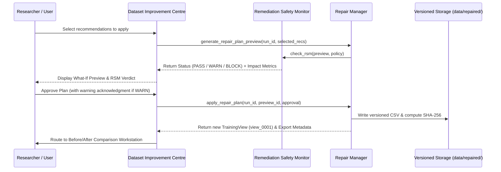

# SmellScope 2.0 / 2.1 — Dataset Improvement Guide

## 1. Overview of the Dataset Improvement Centre

The SmellScope **Dataset Improvement Centre** transforms dataset auditing from a passive reporting dashboard into an active, intelligent scientific improvement platform.

Users can:
1. Review automated, evidence-based repair recommendations.
2. Select target fixes aligned with their research goals.
3. Generate and preview concrete repair plans without altering raw data.
4. Pass proposed changes through the **Remediation Safety Monitor (RSM)**.
5. Apply approved modifications to create an immutable, versioned dataset view.
6. Retrain and re-benchmark the baseline model on the locked test set.
7. Export both the corrected CSV and the complete reproducible model bundle.

---

## 2. Recommendation Taxonomy: Categories A, B, and C

| Category | Scope | Examples | Action Mechanism |
| :--- | :--- | :--- | :--- |
| **Category A: Technical Hygiene** | Data cleaning & numerical stabilization | Missing values, infinite values, constant features, duplicate rows | Median imputation, 99th/1st quantile clipping, deduplication, drop zero-variance features |
| **Category B: Shortcut Elimination** | Feature ablation of non-causal network artifacts | Destination Port, Source IP, Flow ID, Timestamp | R1 Feature Ablation (column suppression from feature set) |
| **Category C: Balance & Distribution** | Class representation & sample adequacy | Severe class imbalance ($> 100:1$), minority class starvation | Majority undersampling, stratified flow quarantine |

---

## 3. Repair Execution Pipeline

---

## 4. Reversible Lineage & Rollback Guarantees

All transformations are completely non-destructive:
- Raw datasets are mounted read-only and never modified in place.
- Each applied repair generates a cryptographically hashed `TrainingView` referencing the parent view ID (`view_0000` $\to$ `view_0001` $\to$ `view_0002`).
- The researcher can roll back any transformation instantly to restore the exact predecessor state via the rollback ledger.
