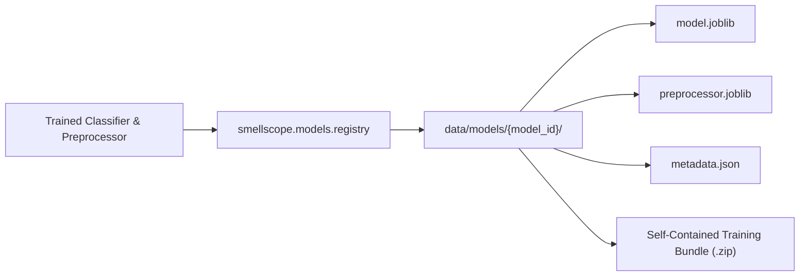

# SmellScope 2.0 / 2.1 — Model Persistence & Reusable Training Bundle Guide

## 1. Overview & Architecture

SmellScope provides complete model persistence and artifact packaging capabilities for models trained on improved dataset views:



---

## 2. Model Registry Directory Structure

Every saved model is stored in a dedicated, versioned subfolder under `data/models/{model_id}/`:

```
data/models/{model_id}/
├── model.joblib                 # Serialized scikit-learn estimator
├── preprocessor.joblib          # Fitted preprocessor pipeline (scalers, encoders, imputer)
└── metadata.json                # Complete provenance, schema, hyperparameters, and metrics
```

### `metadata.json` Schema Specification
```json
{
  "model_id": "model_20261119_054511_e2d78fbf",
  "model_name": "SmellScope-RandomForest-v1",
  "created_at": "2026-11-19T05:45:11.636362+00:00",
  "algorithm": "RandomForestClassifier",
  "model_sha256": "21a1e8fd2e9c48eda67991798a65548819cc02f74bae64490cf1af58c910b211",
  "preprocessor_sha256": "a821d152b26cce6069974d5267842235b4b966752fcc2055322702599607076d",
  "provenance": {
    "run_id": "run_20261119_054036_f5ae84",
    "dataset_id": "cic2017_sample_planted",
    "view_id": "view_0001",
    "dataset_sha256": "abcdef...",
    "n_train_rows": 576,
    "n_features": 11,
    "target_class": "PortScan"
  },
  "schema": {
    "feature_cols": ["Flow_Duration", "Init_Win_bytes_backward", ...],
    "n_features": 11,
    "label_col": "Label",
    "benign_label": "BENIGN",
    "classes": ["BENIGN", "PortScan"]
  },
  "hyperparameters": {
    "n_estimators": 100,
    "max_depth": null,
    "random_state": 42
  },
  "metrics": {
    "train_accuracy": 1.0,
    "val_accuracy": 0.985,
    "test_accuracy": 0.980,
    "test_macro_f1": 0.975,
    "test_fpr": 0.008,
    "test_fnr": 0.035
  },
  "environment": {
    "python": "3.13.12",
    "sklearn": "1.6.1",
    "numpy": "2.2.3",
    "pandas": "2.2.3",
    "joblib": "1.4.2"
  }
}
```

---

## 3. Schema Compatibility Verification

Before applying a persisted model to new or external datasets, SmellScope verifies schema compatibility via `POST /api/v1/models/{model_id}/verify-compatibility`:

1. **Feature Count Match:** Target dataset must contain all required feature columns.
2. **Missing Feature Detection:** Identifies any columns expected by the preprocessor that are absent in the target.
3. **Data Type Consistency:** Compares numerical vs. categorical types against the training schema.
4. **Label Column Availability:** Verifies whether the ground-truth label exists for evaluation, or if the target is unlabelled inference traffic.

If incompatible, inference is safely refused with an explanatory message rather than throwing low-level runtime errors.

---

## 4. The 11-File Reusable Training Bundle (`.zip`)

Researchers can download a self-contained reproducibility archive via `GET /api/v1/models/{model_id}/bundle`. The archive contains:

| # | File Name | Description |
| :---: | :--- | :--- |
| **1** | `improved_train_dataset.csv` | Exact training subset used to fit the model. |
| **2** | `locked_test_dataset.csv` | Untouched locked test partition for independent verification. |
| **3** | `split_manifest.json` | Exact row IDs, random seed, split hash, and partition fractions. |
| **4** | `model.joblib` | Serialized scikit-learn Random Forest estimator. |
| **5** | `preprocessor.joblib` | Serialized preprocessing pipeline (median imputation, scalers). |
| **6** | `feature_and_label_config.json` | Feature list, label column, benign class identifier, and column roles. |
| **7** | `model_config.json` | Complete hyperparameter dictionary and tree configurations. |
| **8** | `transformation_history.json` | Full RSM audit ledger and step-by-step repair history. |
| **9** | `audit_results.json` | Pre-repair smell heuristics, SFI decay values, and GGI scores. |
| **10** | `before_after_comparison.json` | Comprehensive before vs. after data quality and ML metric deltas. |
| **11** | `reproducibility_manifest.json` | Cryptographic SHA-256 hashes for all binary artifacts and Python environment versions. |
| **12** | `README.md` | Clear instructions on how to load and re-evaluate the model in standard Python. |
