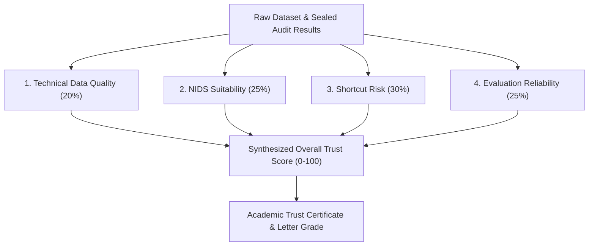

# SmellScope 2.0 / 2.1 — Scoring System & Heatmap Reference

## 1. Multi-Dimensional Dataset Quality Scoring Model

SmellScope synthesizes dataset health into four independent scientific dimensions, scored on a continuous scale of $[0, 100]$:

---

## 2. Dimension Formulations & Penalty Functions

### Dimension 1: Technical Data Quality ($S_{\text{DQ}}$, Weight: 20%)
Measures structural integrity, schema hygiene, and numerical stability:
$$S_{\text{DQ}} = \max\left(0, 100 - P_{\text{missing}} - P_{\text{inf}} - P_{\text{dup}} - P_{\text{const}}\right)$$
- $P_{\text{missing}} = 100 \times \min(0.40, \frac{N_{\text{missing}}}{N_{\text{cells}}} \times 5)$
- $P_{\text{inf}} = 100 \times \min(0.30, \frac{N_{\text{infinite}}}{N_{\text{cells}}} \times 10)$
- $P_{\text{dup}} = 100 \times \min(0.25, \frac{N_{\text{duplicate\_rows}}}{N_{\text{total\_rows}}} \times 2)$
- $P_{\text{const}} = 100 \times \min(0.15, \frac{N_{\text{zero\_variance\_features}}}{N_{\text{features}}} \times 3)$

### Dimension 2: NIDS Benchmark Suitability ($S_{\text{NIDS}}$, Weight: 25%)
Evaluates whether traffic volume, class distribution, and telemetry support realistic NIDS evaluation:
$$S_{\text{NIDS}} = \max\left(0, 100 - P_{\text{imbalance}} - P_{\text{volume}} - P_{\text{telemetry}}\right)$$
- Extreme class imbalance ratio $> 1000:1$ incurs up to $30$ penalty points.
- Missing packet direction or temporal duration metadata incurs $20$ penalty points.

### Dimension 3: Shortcut Risk ($S_{\text{SR}}$, Weight: 30%)
Evaluates whether classifiers learn superficial artifacts rather than attack semantics:
$$S_{\text{SR}} = \max\left(0, 100 - P_{\text{UGT}} - P_{\text{HDF}} - P_{\text{SFI}} - P_{\text{CatA}}\right)$$
- $P_{\text{UGT}} = 30 \times \max_{c} \text{UGT}(c)$ (Target port concentration).
- $P_{\text{HDF}} = 25 \times \max_{c} \max(0, \text{HDF}(c) - 0.70) / 0.30$.
- $P_{\text{SFI}} = 30$ if any class triggers the SFI excessive fragility condition ($z > 2.0, \Delta \text{SFI} > 0.20$).
- $P_{\text{CatA}} = 15$ if top ranking feature belongs to Category A (Environmental/Port).

### Dimension 4: Evaluation Reliability ($S_{\text{ER}}$, Weight: 25%)
Measures test isolation and generalisation validity across domain boundaries:
$$S_{\text{ER}} = \max\left(0, 100 - P_{\text{GGI}} - P_{\text{LOR}} - P_{\text{Leak}}\right)$$
- $P_{\text{GGI}} = 50 \times \min(1.0, \frac{\text{GGI\_gap}}{0.30})$.
- $P_{\text{LOR}} = 25 \times \min(1.0, \max(0, \log_2(\text{LOR})) / 3.0)$.
- $P_{\text{Leak}} = 100$ (Instant zero) if any test row is detected in the training set.

### Overall Synthesized Score ($S_{\text{Overall}}$)
$$S_{\text{Overall}} = 0.20 \cdot S_{\text{DQ}} + 0.25 \cdot S_{\text{NIDS}} + 0.30 \cdot S_{\text{SR}} + 0.25 \cdot S_{\text{ER}}$$

---

## 3. Academic Letter Grade & Interpretation Scale

| Overall Score | Grade | Recommendation / Trust Category | Academic Interpretation |
| :---: | :---: | :--- | :--- |
| **85 – 100** | **A** | **Benchmark Ready** | Scientifically robust; suitable for publication and production evaluation. |
| **70 – 84** | **B** | **Minor Deficiencies** | Usable with caveats; minor feature ablations or deduplication advised. |
| **50 – 69** | **C** | **Remediation Required** | High shortcut risk or data leakage; experimental repair mandatory before trusting. |
| **< 50** | **D / F** | **Unfit for NIDS Evaluation** | Severe design flaws; models trained on this data memorize non-causal artifacts. |

---

## 4. Heatmap Matrix Visual Specification

SmellScope provides three integrated heatmaps on the Findings and Comparison screens:

1. **Per-Class Smell Heatmap Matrix:**
   - Rows: Evaluated attack classes (`PortScan`, `DDoS`, `Botnet`, etc.).
   - Columns: `UGT`, `WL`, `HDF`, `PDD`, `TC`, `SFI Flag`, `ΔSFI`, `GGI Gap`, `LOR`.
   - Cell Styling: Emerald ($< \text{Warning}$), Amber ($\text{Warning} \le v < \text{Critical}$), Rose ($v \ge \text{Critical}$).
2. **Feature Importance & Taxonomy Matrix:**
   - Evaluates top-k predictive features categorized into:
     - **Category A (Rose):** Network artifacts (Destination Port, source IP, flow ID).
     - **Category B (Amber):** Specific attack signatures (Payload flags, burst length).
     - **Category C (Cyan):** Flow dynamics (Inter-arrival time, packet length statistics).
     - **Category D (Emerald):** Standard background traffic characteristics.
3. **Shortcut Fragility Decay Curves:**
   - Visualizes empirical recall drop as perturbation scale $\delta$ steps from $0.0$ to $1.0$.
