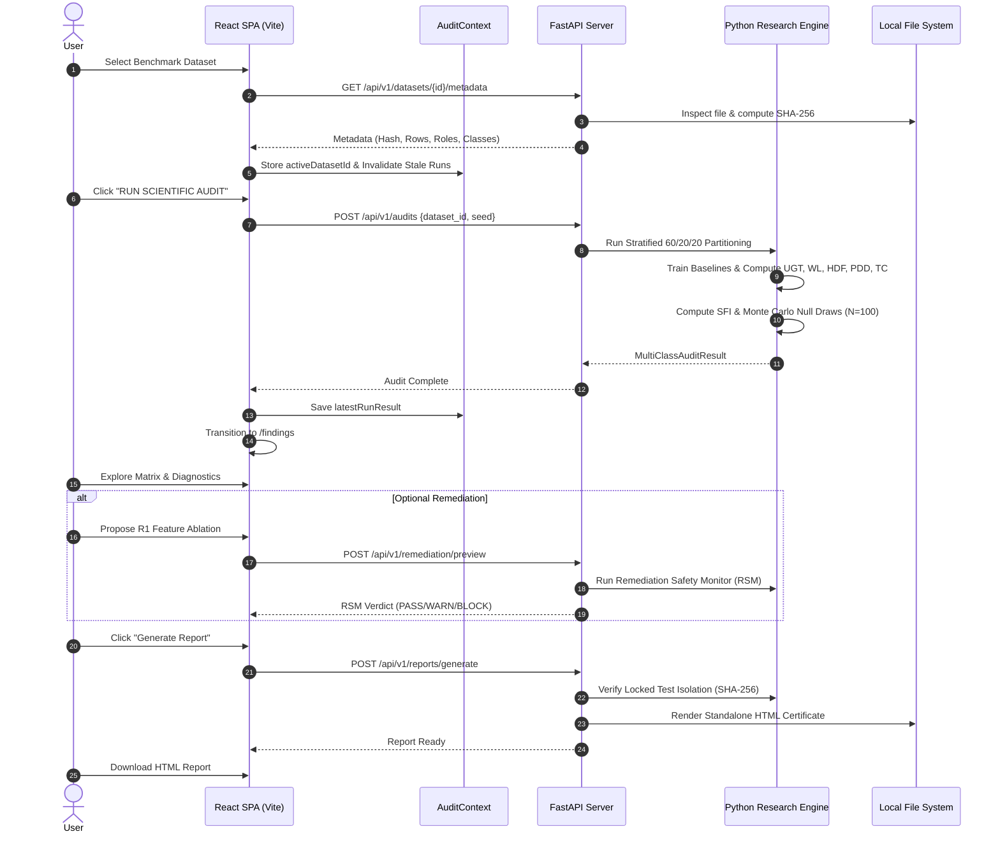

# SmellScope 2.1 — End-to-End Data Flow

## 1. Sequence Diagram: Complete Audit Lifecycle

---

## 2. Invalidation & State Coherence Rules

To prevent displaying misleading or desynchronized results:
1. **Dataset Invalidation**: Changing the active dataset ID immediately resets `activeRunId`, `latestRunResult`, and `remediationViews`.
2. **Locked Split Isolation**: The 20% locked test partition is never modified during remediation previews or view creation.
3. **Rollback Determinism**: Restoring a parent view restores identical data arrays verified by SHA-256 checksums.
