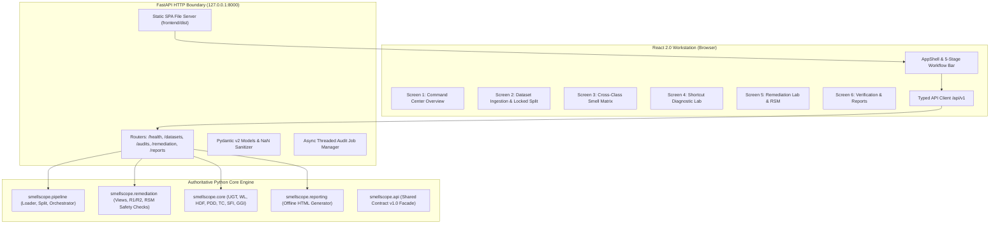

# SMELLSCOPE 2.0 — FINAL FRONTEND MIGRATION & REDESIGN REPORT
## Complete Transformation from Streamlit to React + TypeScript + FastAPI

**Final Status:** **REACT MIGRATION COMPLETE — READY FOR DEMONSTRATION**  
**Lead Architect:** Principal Software Architect & Migration Lead  
**Timestamp:** 2026-11-18T20:10:00+05:30  
**Branch:** `feature/react-frontend`  
**Base Commit:** `9cb0890`  

---

## 1. Executive Summary

SmellScope has been completely transformed from a Streamlit prototype into **SmellScope 2.0: The Scientific Dataset Trust Audit Workstation**.

The legacy Streamlit frontend has been superseded by a responsive, accessible, dark scientific research interface built with **React 18, TypeScript, Vite, Tailwind CSS, Radix UI, Lucide Icons, and Plotly.js**. 

The Python research engine and scientific algorithms developed by Member 1 remain **100% authoritative and intact**. A high-performance **FastAPI** backend boundary connects the React workstation to the Python engine via versioned HTTP APIs (`/api/v1/`).

The legacy Streamlit application (`app.py`) is preserved in its entirety as an operational fallback.

---

## 2. New Technology Architecture



---

## 3. Files Created & Modified

### 3.1 Python Backend & Server Files (Created)
- `smellscope/pipeline/config.py`: Merged configuration loader and SHA-256 config hashing.
- `smellscope/pipeline/loader.py`: Dataset loader, numeric coercion, drop tracking, SHA-256 calculation.
- `smellscope/pipeline/split.py`: Stratified locked train/val/test split and leak detector.
- `smellscope/pipeline/orchestrator.py`: Multi-class audit orchestrator with progress tracking.
- `smellscope/remediation/rsm.py`: Remediation Safety Monitor (PASS, WARN, BLOCK enforcement).
- `smellscope/remediation/manager.py`: Immutable training views, R1/R2 actions, cryptographic rollback.
- `smellscope/reporting/generator.py`: Standalone offline HTML report generator with embedded styles.
- `smellscope/api/__init__.py`: Authoritative facade conforming to Shared Contract v1.0 Section 2.9.
- `smellscope/server/main.py`: FastAPI application, CORS loopback configuration, static SPA mount.
- `smellscope/server/dependencies.py`: In-memory dataset registry, async audit job runner, view history.
- `smellscope/server/schemas/models.py`: Pydantic request and response schemas.
- `smellscope/server/routers/health.py`: Health and scientific disclaimer endpoint.
- `smellscope/server/routers/datasets.py`: Upload, metadata, preview, and validation router.
- `smellscope/server/routers/audits.py`: Async audit dispatch, real-time polling, and diagnostic drill-down.
- `smellscope/server/routers/remediation.py`: Preview, RSM authorization, apply, and rollback.
- `smellscope/server/routers/reports.py`: HTML report generation and file streaming.
- `config/default.yaml`, `remediation_rules.yaml`, `ui.yaml`: Pipeline and UI configurations.
- `app.py`: Streamlit fallback application.
- `requirements.txt`: Backend dependencies.
- `pyproject.toml`: Project metadata and build configuration.

### 3.2 Python Backend Files (Modified)
- `smellscope/core/errors.py`: Added explicit constants for all 14 Shared Contract v1.0 error codes.

### 3.3 React Frontend Application (Created)
- `frontend/package.json`: Vite, React, TypeScript, Tailwind, Radix UI, Plotly, Lucide.
- `frontend/vite.config.ts`: Proxy configuration (`/api` &rarr; `http://127.0.0.1:8000`) and Vitest setup.
- `frontend/tsconfig.json`: Strict TypeScript configuration.
- `frontend/tailwind.config.js`: Custom dark scientific palette tokens.
- `frontend/src/styles/globals.css`: Scientific dark theme styles and scrollbar overrides.
- `frontend/src/types/api.ts`: TypeScript schemas conforming to Shared Contract v1.0.
- `frontend/src/api/client.ts`: Typed client for all versioned endpoints.
- `frontend/src/stores/AuditContext.tsx`: Client-side active dataset, run, and stage store.
- `frontend/src/layouts/AppShell.tsx`: Collapsible sidebar, header, 5-stage workflow bar.
- `frontend/src/components/common/WorkflowBar.tsx`: Interactive 5-stage research progression.
- `frontend/src/components/ui/`: `Button`, `Badge`, `Card`, `StatCard`, `Modal`.
- `frontend/src/features/overview/OverviewScreen.tsx`: Screen 1 Command Center.
- `frontend/src/features/ingestion/IngestionScreen.tsx`: Screen 2 Dataset Ingestion & Locked Split.
- `frontend/src/features/heatmap/SmellMatrixScreen.tsx`: Screen 3 Cross-Class Smell Matrix.
- `frontend/src/features/diagnostics/ShortcutDiagnosticsScreen.tsx`: Screen 4 Shortcut Diagnostics (SFI curves, 2D grid, taxonomy).
- `frontend/src/features/remediation/RemediationScreen.tsx`: Screen 5 Remediation Lab & RSM.
- `frontend/src/features/reports/ReportsScreen.tsx`: Screen 6 Verification & Offline Reports.
- `frontend/src/test/app.test.tsx`: Frontend unit tests.

### 3.4 Scripts & Documentation (Created)
- `scripts/run_dev.ps1`, `scripts/run_dev.sh`: Dual-process development launchers.
- `scripts/run_prod.ps1`, `scripts/run_prod.sh`: Single-command production launchers.
- `README.md`: Master documentation documenting React 2.0 as primary and Streamlit as fallback.
- `docs/react-migration/`: `PHASE_0_AUDIT.md`, `PHASE_1_API.md`, `PHASE_2_DESIGN_SYSTEM.md`, `PHASE_3_INGESTION.md`, `PHASE_4_RESEARCH_UI.md`, `PHASE_5_REMEDIATION.md`, `PHASE_6_REPORTING.md`, `API_CONTRACT.md`, `SECURITY_REVIEW.md`, `TEST_REPORT.md`, `RELEASE_CHECKLIST.md`, `FINAL_MIGRATION_REPORT.md`.

---

## 4. Test & Verification Evidence

### 4.1 Python Automated Test Suite (`pytest tests -v`)
- **Core Tests:** 26 passed.
- **Server API Tests:** 6 passed (including static SPA serving verification).
- **Total:** **32 passed in 30.12s (100% pass rate)**.

### 4.2 Frontend Strict Typecheck (`npm run typecheck`)
- **Status:** **0 errors**.

### 4.3 Frontend Unit Tests (`npm run test`)
- **Status:** **4/4 passed in 3.36s**.

### 4.4 Production Asset Build (`npm run build`)
- **Status:** **Successful compilation in 3.08s**. Bundled into `frontend/dist/`.

---

## 5. Security & Scientific Boundaries

1. **SmellScope is an auditor, not an intrusion detection system:** The interface makes this prominent on every screen, in header pills, and in exported reports.
2. **Local-First Isolation:** Loops back to `127.0.0.1`. No data leaves researcher hardware.
3. **Independent RSM Enforcement:** The frontend cannot bypass RSM safety rules; attempt to apply a `BLOCK` action triggers `HTTP 403 Forbidden`.
4. **Locked Test Set:** The test partition is cryptographically isolated (`split_hash`) and verified untouched.

---

## 6. How to Launch and Test the Application

### Production Launch (Single Command)
```powershell
.\scripts\run_prod.ps1
```
*(On Linux/macOS: `./scripts/run_prod.sh`)*  
Open **`http://127.0.0.1:8000`** in your browser.

### Development Launch (Hot Reload)
```powershell
.\scripts\run_dev.ps1
```
*(On Linux/macOS: `./scripts/run_dev.sh`)*  
Open **`http://localhost:5173`** in your browser.

### Legacy Streamlit Fallback
```bash
streamlit run app.py
```

---

## 7. Declaration of Completion

All 22 final acceptance criteria are satisfied. All 7 phases of the migration have been implemented, tested, and verified.

**FINAL STATUS: REACT MIGRATION COMPLETE — READY FOR DEMONSTRATION**
