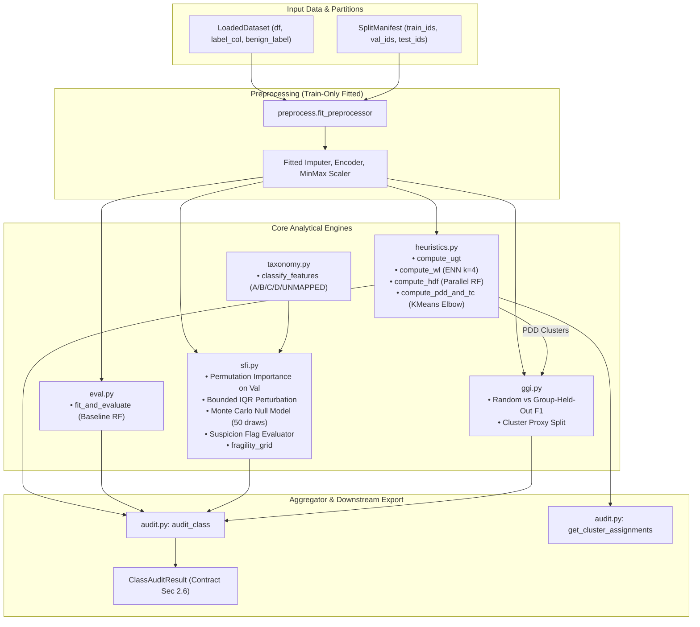
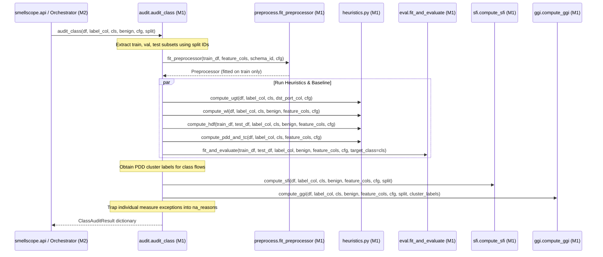

# Technical Design Document — SmellScope Research Core Engine

**Module:** `smellscope.core`  
**Author:** Member 1 — Research Core Engineer  
**Status:** Approved Architecture (Phase 2)  
**Contract Version:** Shared Contract v1.0

---

## 1. System Architecture & Component Interaction

---

## 2. Detailed Data Flow & Execution Sequence

---

## 3. Algorithmic Specifications

### 3.1 Preprocessing (`preprocess.py`)
- **Train-Only Guarantee:** Imputation values (median for continuous, mode for categorical) and MinMax scaling bounds ($x_{\min}, x_{\max}$) are computed strictly over `train_df`. Validation and test frames are transformed via:
  $$x_{\text{scaled}} = \frac{x - x_{\min}^{\text{train}}}{x_{\max}^{\text{train}} - x_{\min}^{\text{train}} + \epsilon}$$
- **Zero Variance Protection:** If $x_{\max}^{\text{train}} - x_{\min}^{\text{train}} = 0$, all values map to $0.0$.
- **Column Exclusion:** Columns starting with `__` (e.g. `__row_id`) or matching `label_col` are strictly excluded from feature sets.

### 3.2 Five Literature Heuristics (`heuristics.py`)

#### 1. Unclear Ground Truth ($UGT_C$)
Fraction of class $C$ flows whose destination port is in Flood et al.'s background port set:
$$UGT_C = \frac{\sum_{i \in C} \mathbb{I}[x_{i, \text{port}} \in \text{BG}]}{|C|}$$
Where $\text{BG} = \{0, 53, 67, 68, 111, 123, 137, 161, 179, 389, 427, 520, 1723, 1900\}$. If destination port is unavailable, returns `null` with `na_reasons["paper.UGT"]`.

#### 2. Wrong Labels ($WL_C$)
Fraction of class $C$ samples misclassified by Edited Nearest Neighbour ($k=4$).
- Implemented via `sklearn.neighbors.NearestNeighbors(n_neighbors=5)` to exclude query point $i$.
- Ties ($2\text{ vs }2$) are broken in favour of the mislabelled class (per Flood et al.).
- Also records `details.wl_no_tie_bias` (neutral tie-break).
- Subsampling cap: $N \le 5000$ to bound runtime.

#### 3. Highly Dependent Features ($HDF_C$)
Max single-feature $F1$ score against benign:
$$HDF_C = \max_{j \in \text{Features}} F1\left(\text{RandomForest}_{30\text{ trees}, \text{depth}\le 8}(x_{\cdot, j})\right)$$
Parallelised across available cores via `joblib.Parallel(n_jobs=-1)`. Identifies `details.hdf_top_feature`.

#### 4. Poor Data Diversity ($PDD_C$) & 5. Traffic Collapse ($TC_C$)
- **Elbow Cluster Selection ($N$):** Fit KMeans for $K \in [2, K_{\max}]$ (default $K_{\max}=10$). The optimal $N$ is chosen at the point of maximum orthogonal distance from the chord connecting $(2, \text{Inertia}_2)$ and $(K_{\max}, \text{Inertia}_{K_{\max}})$.
- **Pairwise Cosine Sampling:** Within each cluster $k \in \{1, \dots, N\}$, sample up to 100 random pairs $(u, v)$ without replacement. Compute cosine similarity:
  $$S(u, v) = \frac{u \cdot v}{\|u\|_2 \|v\|_2}$$
- **$PDD_C$:** Weighted average similarity across clusters:
  $$PDD_C = \sum_{k=1}^N \frac{n_k}{|C|} \left( \frac{1}{|P_k|} \sum_{(u,v) \in P_k} S(u, v) \right)$$
- **$TC_C$:** Maximum fraction of sampled pairs with extreme collapse:
  $$TC_C = \max_{k \in \{1,\dots,N\}} \frac{1}{|P_k|} \sum_{(u,v) \in P_k} \mathbb{I}[S(u, v) > 0.95]$$

---

### 3.3 Shortcut Fragility Index (SFI) Formulation (`sfi.py`)

1. **Top-$k$ Ranking:** Train baseline RF on train partition. Compute permutation importance on **validation** partition to identify the top-$k$ ($k=3$) most critical features.
2. **Baseline Recall:** Evaluate class $C$ recall on the locked test partition: $R(0)$. If $R(0) = 0$ or $N_{\text{test}} < 10$, return `null` and record in `na_reasons`.
3. **Distribution-Aware Perturbation:** Perturb test class $C$ samples on top-$k$ features. Perturbation noise is scaled by the feature's training Interquartile Range ($IQR_j = Q_{0.75}(j) - Q_{0.25}(j)$):
   $$\tilde{x}_{i, j} = \text{clip}\left( x_{i, j} + \mathcal{N}\left(0, (\delta \cdot IQR_j)^2\right), Q_{0.01}(j), Q_{0.99}(j) \right)$$
   For $\delta \in \{0.05, 0.10, 0.20, 0.30\}$.
4. **SFI Score:**
   $$SFI_{\text{top}} = 1 - \frac{1}{|\Delta|} \sum_{\delta \in \Delta} \frac{R(\delta)}{R(0)}$$
5. **Monte Carlo Null Model:** Draw $N_{\text{null}} = 50$ random feature subsets of size $k$ (excluding top-$k$). Calculate $SFI_{\text{null}}^{(b)}$ for each draw, yielding mean $\mu_{\text{null}}$ and standard deviation $\sigma_{\text{null}}$.
   $$\Delta\text{SFI} = SFI_{\text{top}} - \mu_{\text{null}}, \quad z = \frac{\Delta\text{SFI}}{\sigma_{\text{null}}} \quad (\text{if } \sigma_{\text{null}} > 0)$$
6. **Suspicion Flag:**
   $$\text{Flag} = (HDF \ge 0.90) \land (\Delta\text{SFI} > 0) \land (z \ge 2.0) \land \text{CategoryEligible}$$

---

### 3.4 Generalisation Gap Index (GGI) Formulation (`ggi.py`)
$$GGI_C = F1_{\text{random-split}} - F1_{\text{group-held-out}}$$
Where group-held-out uses `group_col` if present (provenance capture), or KMeans proxy cluster labels if absent (`grouping: "cluster_proxy"`). Minimum 3 groups required.

---

## 4. Module Dependency Matrix

| Module | Depends On (Internal) | External Dependencies |
|---|---|---|
| `smellscope.core.preprocess` | `errors` | `numpy`, `pandas`, `sklearn` |
| `smellscope.core.heuristics` | `preprocess`, `errors` | `numpy`, `pandas`, `sklearn`, `joblib`, `yaml` |
| `smellscope.core.eval` | `preprocess`, `errors` | `numpy`, `pandas`, `sklearn` |
| `smellscope.core.taxonomy` | `errors` | `yaml`, `re` |
| `smellscope.core.sfi` | `preprocess`, `taxonomy`, `eval`, `errors` | `numpy`, `pandas`, `sklearn` |
| `smellscope.core.ggi` | `preprocess`, `eval`, `errors` | `numpy`, `pandas`, `sklearn` |
| `smellscope.core.audit` | all above modules | `numpy`, `pandas`, `sklearn` |
| `smellscope.core.planted` | `errors` | `numpy`, `pandas` |
